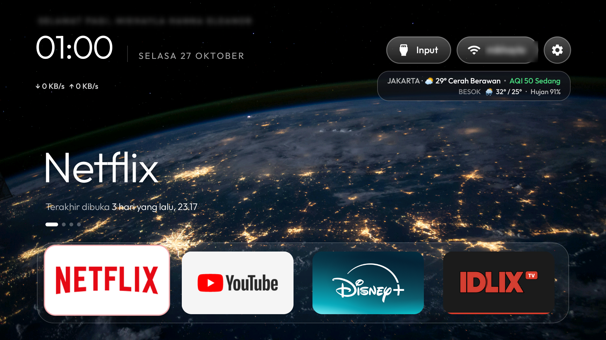

# Papay TV Launcher - Custom Home for TCL BeyondTV

A customized build of the [cleanyourtv](https://github.com/Gathin23/cleanyourtv) launcher (v2.7, versionCode 8) with a Liquid Glass look, Jakarta weather, PS5-style navigation sounds, and a wallpaper-synced idle screensaver. Built and tested on a **TCL BeyondTV (Android TV 9, API 28)**.



## Features

- **Liquid Glass theme** (`glass_style: rim`) with PS5 navigation/select sounds.
- **Jakarta weather + AQI** (Open-Meteo) and Wi-Fi traffic rate under the clock.
- **Glass weather card** under the top pills: current conditions, AQI, and tomorrow's forecast with rain chance. Right edge aligns with the settings gear.
- **Named greeting**: `greeting_name` is shown in the header and on the screensaver.
- **Wi-Fi pill shows the connected SSID** (set `wifi_label_width` to fit your SSID); clicking it opens a glass network picker.
- **Gear menu**: click = glass dropdown (Wallpaper + TV Settings), long press = full Settings menu.
- **Wallpaper picker** with a rotating collection; the last displayed picture is saved and survives reboots, and Home and the screensaver always show that same picture.
- **Idle screensaver** (`dream_clock.xml` + `ClockScene.java`): huge thin clock, greeting, date, and a glass weather card over the current wallpaper, dimmed by `clock_wallpaper_dim`.
- **No color gradients**: hero art, scrim, ambient glow, and app glow disabled so the wallpaper shows clean.

## Files

| Path | What it is |
|---|---|
| `mikhayla-glass-home-2.7.apk` | Ready-to-install APK (635 KB) |
| `config.example.json` | Runtime config pushed to the TV (edit names/SSID to taste) |
| `patch/` | All source files changed vs. upstream cleanyourtv v2.7 |
| `sounds/` | Navigation sound packs baked into the APK: PS5 (default), Nintendo Switch, Xbox |
| `wallpapers/` | 44 wallpaper images from the glass-tv-home theme sets: `unsplash-dark-4k` (30), `mac-aerials` (11), `aurora-pixel` (3) |
| `debloat/` | The exact package-disable list applied on TV-1 (51 packages) |
| `screenshots/` | Home and screensaver on an actual TCL BeyondTV |

## Install on a fresh TV (replay kit)

`setup.ps1` reproduces TV-1's exact setup - launcher + config + wallpapers + debloat - in one command:

```powershell
powershell -ExecutionPolicy Bypass -File setup.ps1 -TvHost 192.168.1.50 -GreetingName "Mikhayla"
```

Enable Network ADB debugging on the TV first, and make sure the PC and TV share one Wi-Fi network.

What it does, in order:

1. `adb connect` to the TV.
2. Installs `mikhayla-glass-home-2.7.apk` (PS5 sounds are already inside it).
3. Builds a `config.json` from `config.example.json` and pushes it (with your greeting name).
4. Pushes the 44 wallpapers into the app's `files/wallpapers/` dir.
5. Sets the launcher as Home (`cmd package set-home-activity`) and wires the screensaver (`ClockDream`), **only then** - never before the new Home is confirmed:
6. Runs the debloat: 51 packages from `debloat/packages-disabled.txt`, each with `pm disable-user --user 0` (never uninstall), following the cleanyourtv safety rules. Packages not present on your unit are skipped.

`undo.ps1` reverses everything: re-enables all 51 packages and resets the screensaver.

Not included: iDLIX (a third-party store APK - install it yourself if you want it) and anything carrying your personal data. Remove apps your family actually uses from the list first - the "ask before anything the family uses" rule from the base repo applies.

## Manual install

```powershell
adb connect <TV-IP>:5555
adb install -r mikhayla-glass-home-2.7.apk
adb push config.example.json /sdcard/Android/data/com.gathin.tvhome/files/config.json
adb push wallpapers/unsplash-dark-4k /sdcard/Android/data/com.gathin.tvhome/files/wallpapers/
adb push wallpapers/mac-aerials /sdcard/Android/data/com.gathin.tvhome/files/wallpapers/
adb shell am force-stop com.gathin.tvhome
adb shell input keyevent 3
```

Then set the launcher as Home and enable "Table clock / Daydream" in the TV's Screen settings (idle 5 min). The sounds (`ps5_nav.wav`, `ps5_select.wav`, ...) are already compiled into the APK (`res/raw`); they sit in `sounds/` only so you can rebuild with a different pack. PS5 is the default set used at runtime.

## Key config options

- `greeting_name` - name shown in the greeting (Home + screensaver).
- `wifi_label_width` - width (dp) of the SSID label next to the Wi-Fi icon.
- `clock_wallpaper` / `clock_wallpaper_dim` - screensaver wallpaper + dim %.
- `home_idle_clock_minutes` - screensaver idle delay.
- `cinematic_art` / `cinematic_scrim` / `ambient_glow` / `app_glow` - all set to 0/off for a clean, gradient-free look.
- `wallpaper_choice` - default wallpaper when no saved choice exists.

## Notes for your own TV

- Everything disabled is reversible (`pm disable-user`, never uninstalled).
- The wallpaper set is not bundled in the APK; it lives in the app's external files dir.
- Weather is Jakarta-only (`Asia/Jakarta`, id-ID) by design.

## Rebuilding from source

1. Clone `Gathin23/cleanyourtv` v2.7.
2. Replace the files under `app/src/main/...` with those in `patch/` (paths mirror the upstream tree).
3. `./gradlew assembleRelease` (JDK 17).

## Credits & notes

- Launcher base: [Gathin23/cleanyourtv](https://github.com/Gathin23/cleanyourtv)
- Glass theme assets & wallpapers: glass-tv-home theme sets (`unsplash-dark-4k`, `mac-aerials`, `aurora-pixel` - photos sourced from Unsplash/gallery captures; see the original repo for photo credits)
- **PS5 / Switch / Xbox sounds are not ours**: they are Sony/Nintendo/Microsoft UI sounds, kept here for personal use on your own TV. Don't use them commercially.
- Weather data: [Open-Meteo](https://open-meteo.com/)
